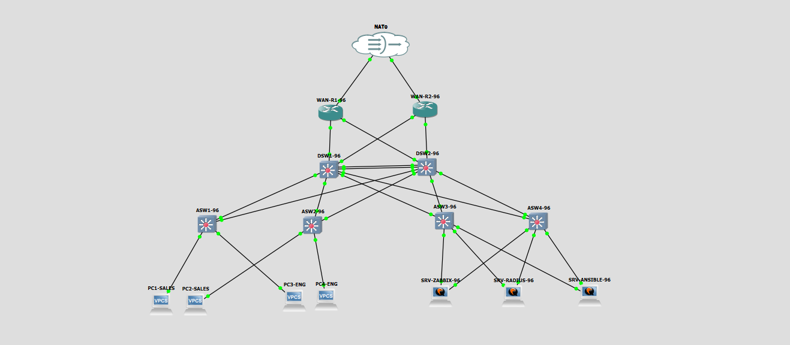

# Bài tập lớn - Quản trị Mạng (Network Management Project)
## Bài tập lớn 1:
Thiết kế và triển khai hạ tầng mạng Doanh nghiệp dự phòng cao. Mục tiêu hướng đến xây dựng hạ tầng mạng mô hình 3 lớp (Core, Distribution, Access) bền vững, loại bỏ các điểm lỗi đơn lẻ. Các nội dụng chính cần thực hiện bao gồm: Quy hoạch vùng địa chỉ IPAM sử dụng kỹ thuật VLSM và phân vùng VLAN/Inter, VLAN Routing. Cấu hình dự phòng Lớp 2: RSTP (chống bão Broadcast) và EtherChannel (LACP) gộp kênh băng thông. Cấu hình dự phòng Lớp 3 Gateway: HSRP hoặc VRRP với cơ chế chia tải chéo 
(Active/Standby Load Balancing) giữa các VLAN.

## Bài tập lớn 2:
> Note: Pending for update

## Topology:

## Thành viên - Nhiệm vụ:
> Note: Project folder là 'BTL_v0'
1. Dương:
- [x] Thiết kế Topology trên GNS3 Server (IOU L2/L3, Ubuntu 22.04).
- [x] Quy hoạch bảng IPAM/VLSM chi tiết cho dải 10.96.0.0/16 (VLAN 10, 20, 30, 99 + các subnet /30 P2P).
- [x] Cấu hình cặp WAN-R1-96 & WAN-R2-96: OSPF, NAT Overload ra Cloud Internet.
- [x] Kiểm tra và giám sát tiến độ Bài tập lớn 1.
> Note: Khi mở console của 2 con Router sẽ yêu cầu đăng nhập, với username: admin_96 và password là: Pass_96@CO3151

2. Huy
- [x] Phụ trách 4 Switch Access (SW-A1-96 đến SW-A4-96).
- [X] Cấu hình VLAN 10, 20, 30, 99, Trunking 802.1Q, đồng bộ Native VLAN.
- [x] Kích hoạt PortFast & BPDU Guard trên các cổng nối PC/Server.
- [x] Vẽ sơ đồ cây RSTP (Root/Designated/Alternate Port) cho báo cáo.

3. Nghĩa
- [x] Phụ trách cặp Multilayer Switch (SW-D1-96, SW-D2-96) và đường High-Speed EtherChannel LACP nối giữa chúng.
- [x] Cấu hình SVI Inter-VLAN Routing (10, 20, 30, 99) và OSPF nối lên 2 Border Router.
- [x] Cấu hình HSRP Group 96 (VIP .254) chia tải chéo (D1 Active VLAN 10, 99; D2 Active VLAN 20, 30) kèm preempt & Interface Tracking.
- [x] Cấu hình RSTP Root Bridge Primary/Secondary đồng bộ với HSRP và bật Root Guard.

4. Kiên
- [x] Phụ trách các máy trạm PC (VLAN 10, 20) và 3 máy chủ Ubuntu (kèm Linux Bonding) (VLAN 30) ở mức kết nối mạng cơ bản.
- [x] Thực thi kịch bản Failover Test (ngắt cổng Uplink, tắt Switch Distribution), đo thời gian hội tụ 1–2s bằng ping/traceroute.
- [x] Xuất toàn bộ running-config, biên tập Báo cáo BTL1_BaoCao_NhomXX.pdf và Slide BTL1_Slide_NhomXX.pptx.

## Quy hoạch IPAM - VLSM:
Đây là bảng quy hoạch địa chỉ IPAM và chia mạng con VLSM.
[IPAM - VLMS](Docs/ipam_vlsm_subnetting_plan.md)

## Danh sách đấu nối cổng:
Đây là bảng đấu nối cáp mạng.
[Port mapping](Docs/master_patching_matrix.md)

## Báo cáo:
Các file PDF và Slide trình bày về Bài tập lớn 1.
[PDF](Docs/BTL1_Slide_Nhom96.pdf)
[Slide](Docs/BTL1_Slide_Nhom96.pptx)