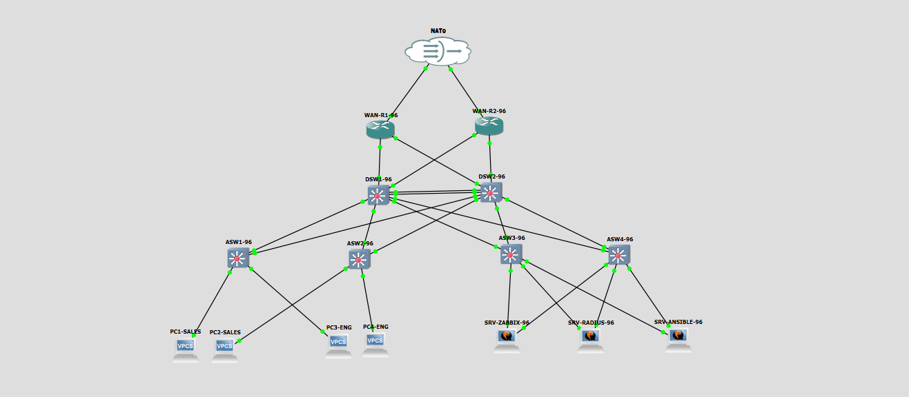

# Bài tập lớn 1 Quản trị Mạng
## Topology:

## Thành viên - Nhiệm vụ:
> Note: Project folder là 'BTL_v0'
1. Dương:
- [x] Thiết kế Topology trên GNS3 Server (IOU L2/L3, Ubuntu 22.04).
- [x] Quy hoạch bảng IPAM/VLSM chi tiết cho dải 10.96.0.0/16 (VLAN 10, 20, 30, 99 + các subnet /30 P2P).
- [x] Cấu hình cặp WAN-R1-96 & WAN-R2-96: OSPF, NAT Overload ra Cloud Internet.
- [ ] Thiết lập chuẩn quản trị cơ sở trên toàn mạng: Hostname -96, Secret Pass_96@CO3151, SSHv2, SVI VLAN 99.
2. Huy
...
3. Nghĩa
...
4. Kiên
...
## Quy hoạch IPAM - VLSM:
[IPAM - VLMS](Docs/ipam_vlsm_subnetting_plan.md)

## Danh sách đấu nối cổng:
[Port mapping](Docs/master_patching_matrix.md)
